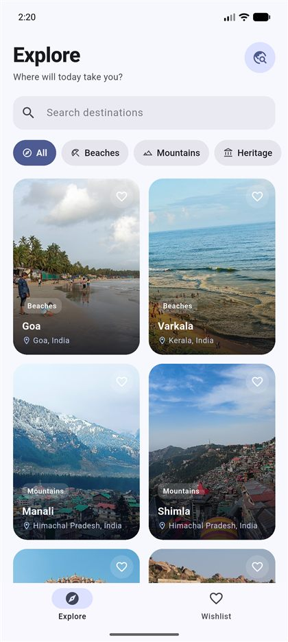
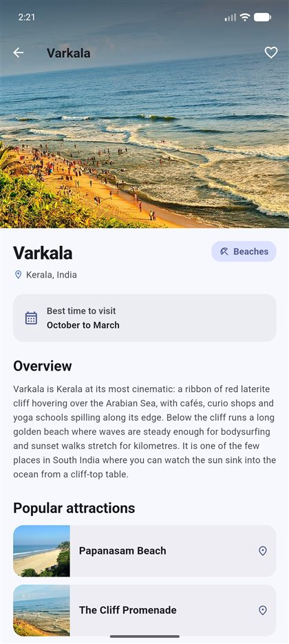
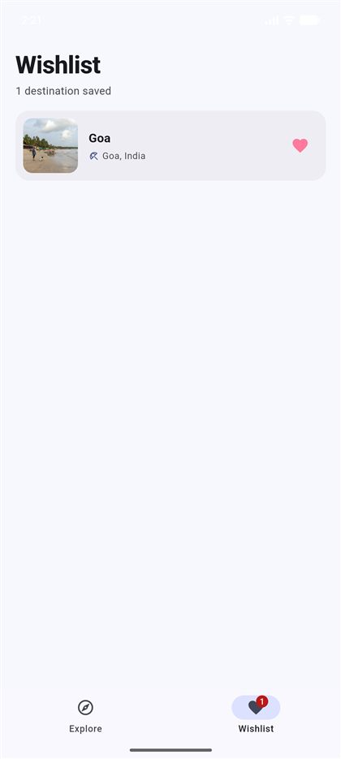

# Travel Explorer

<p align="center">
  
  
  
</p>

Travel Explorer is a mobile app built with Flutter that helps you discover
beautiful destinations across India. Browse beaches, mountains, heritage
sites and adventure getaways, dive into destination details, search and
filter by name or category, and keep a personal wishlist of places you'd
love to visit.

No account, sign-up or API key is required. Destination content, search,
filters and the wishlist all run from data bundled with the app; destination
photos are streamed from Wikimedia Commons over HTTPS, with a fallback
placeholder whenever a photo cannot be loaded.

## Features

- **Explore destinations** — a discovery feed of eight curated destinations
  across India (Goa, Varkala, Manali, Shimla, Jaipur, Hampi, Rishikesh and
  Spiti Valley) covering beaches, mountains, heritage and adventure.
- **Rich destination details** — large hero photography, a written overview,
  the best time to visit, and popular attractions with photos.
- **Search** — find destinations by name with case-insensitive matching and
  a one-tap clear button.
- **Category filters** — quickly narrow the feed to All, Beaches, Mountains,
  Heritage or Adventure. Filters combine with search.
- **Wishlist** — save destinations with the heart on any screen, view them
  in one place, remove them again, and stay in sync everywhere in the app.
- **Polished experience** — Material 3 theming with light and dark mode,
  smooth hero transitions between the grid and details, loading indicators
  and graceful fallbacks for images, and friendly empty states.

## Technology Stack

- [Flutter](https://flutter.dev) with Material 3 components
- [Dart](https://dart.dev)
- Local, in-app static data (no backend, no third-party services)
- ChangeNotifier-based shared state for the wishlist

## Prerequisites

- Flutter SDK 3.47 or newer (`flutter doctor` should show no issues)
- An Android SDK for the Android emulator, or Xcode for the iOS simulator
  (only needed when running on that platform)

## Getting Started

1. Clone the repository and move into the project folder:

   ```bash
   git clone <repository-url>
   cd travel_explorer
   ```

2. Fetch the package dependencies:

   ```bash
   flutter pub get
   ```

3. Make sure a device or emulator is available:

   ```bash
   flutter devices
   ```

4. Run the app:

   ```bash
   flutter run
   ```

Useful commands during development:

```bash
flutter analyze      # static analysis
flutter test         # unit tests
dart format lib test # format the source code
```

## Project Structure

```
lib/
├── main.dart                          # App entry point, theme and navigation shell
├── models/
│   └── destination.dart               # Destination, Attraction and category models
├── data/
│   └── destination_data.dart          # The bundled destination catalog and search helpers
├── state/
│   ├── app_state.dart                 # Shared wishlist state (ChangeNotifier)
│   └── app_state_scope.dart           # Provides AppState to the widget tree
├── screens/
│   ├── home_screen.dart               # Explore feed: search, filters, card grid
│   ├── destination_details_screen.dart # Destination detail page
│   └── wishlist_screen.dart           # Saved destinations
└── widgets/
    ├── destination_card.dart          # Card used in the explore grid
    ├── category_filter_bar.dart       # Horizontally scrolling category chips
    ├── remote_image.dart              # Image widget with loading/error handling
    └── empty_state.dart               # Shared empty-state view

test/
├── destination_app_test.dart          # Tests for search, filtering and wishlist logic
└── widget_flow_test.dart              # Widget tests for search/clear and wishlist sync

docs/screenshots/                      # Screenshots used in this README
```

## Screenshots

Captured from the Android emulator while running the app.

| Explore | Destination details | Wishlist |
| ------- | ------------------- | -------- |
|  |  |  |

## License

Released under the [MIT License](LICENSE).
